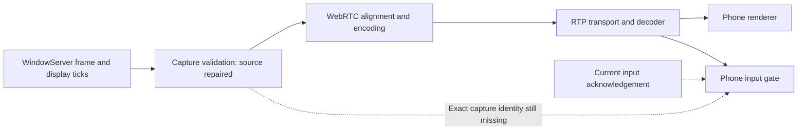

# Establish capture evidence before claiming a recovered screen is current

Source repair at capture admission; end-to-end frame proof remains open. This continues the [presentation recovery](INPUT_PRESENTATION_RECOVERY_REVIEW.md), [source ownership](INPUT_SOURCE_OWNERSHIP_REVIEW.md) and [activity](INPUT_ACTIVITY_REVIEW.md) repairs. No build, typecheck, test/assertion execution, app/device/browser operation, model run or SSH retry was performed. SDK headers and upstream repository/documentation files were read. No framework/model artifact was downloaded, rebuilt or replaced.

## First-principles findings

The person acts on the displayed Mac screen. Permission to send input therefore needs a causal connection to that screen, not merely an authenticated control channel and a decoder callback that happened later. Control and video travel through separate queues. An acknowledgement may overtake old media, and a paused phone may show an old frame when it becomes active again.

The Mac previously forwarded any valid sample buffer that contained an image, without checking ScreenCaptureKit's frame status. It converted the sample presentation timestamp through floating-point seconds to `Int64` nanoseconds. Invalid, infinite, negative or unrepresentable times could reach that conversion; large timestamps could also lose integer precision. The phone's current probe identifies its registration/track/handshake but receives no proof tying its decoded frame to capture after that handshake.

A valid capture timestamp is a necessary input to the missing proof, not that proof itself. A strictly increasing timestamp can still describe a frame captured before the latest input recovery boundary.

## Authoritative clock and API evidence

Apple's [frame metadata documentation](https://developer.apple.com/documentation/screencapturekit/scstreamframeinfo) describes the sample attachments. Its [complete-frame status](https://developer.apple.com/documentation/screencapturekit/scframestatus/complete) identifies a newly generated frame, while idle/blank/suspended/stopped statuses are different events. The [capture sample](https://developer.apple.com/documentation/screencapturekit/capturing-screen-content-in-macos?changes=_9) checks for complete status before processing a frame.

The local macOS SDK `SCStream.h` documents display-time attachments as mach absolute time of the WindowServer display event. `CMSync.h` documents conversion between those native host-clock units and `CMTime`. These are clock-scale conversions; the sample's media presentation time and callback arrival time remain separate values. The [public display-time page](https://developer.apple.com/documentation/screencapturekit/scstreamframeinfo/displaytime) identifies the same WindowServer event.

The checked-in package pin is LiveKit WebRTC **144.7559.3**, with a binary URL ending **144.7559.03**, in [the pinned manifest](https://github.com/livekit/webrtc-xcframework/blob/f6017e189972b86f90e0ec406b1629828bc75748/Package.swift). The locally cached public `RTCVideoFrame.h` exposes nanosecond and 90 kHz timestamps but does not document an end-to-end identity guarantee.

Additional source review was pinned to M144 reference **30d5e63ae91da483e06577b5c35ee91cc5e5c3db**:

| Stage | Observed source behavior | Consequence |
|---|---|---|
| [Objective-C capture source](https://github.com/webrtc-sdk/webrtc/blob/30d5e63ae91da483e06577b5c35ee91cc5e5c3db/sdk/objc/native/src/objc_video_track_source.mm) | Divides nanoseconds to microseconds, then aligns them to WebRTC's clock. | The supplied capture timestamp is transformed. |
| [Native-to-Objective-C frame bridge](https://github.com/webrtc-sdk/webrtc/blob/30d5e63ae91da483e06577b5c35ee91cc5e5c3db/sdk/objc/native/src/objc_video_frame.mm) | Exposes a native RTP timestamp and native timestamp in nanoseconds. | These fields are not the original unmodified sample clock. |
| [RTP sender](https://github.com/webrtc-sdk/webrtc/blob/30d5e63ae91da483e06577b5c35ee91cc5e5c3db/call/rtp_video_sender.cc) | Adds its stream's start timestamp to the encoded-image RTP timestamp. | An encoder timestamp cannot simply be compared to a receiver RTP timestamp. |
| [Decoder bridge](https://github.com/webrtc-sdk/webrtc/blob/30d5e63ae91da483e06577b5c35ee91cc5e5c3db/sdk/objc/native/src/objc_video_decoder_factory.mm) | Copies the decoder callback's RTP timestamp into a native frame and initializes native timestamp milliseconds to zero. | Renderer nanoseconds are not proof of original Mac capture time. |

This reference is evidence about the reviewed M144 source, not verified source provenance for the installed binary. The [build release](https://github.com/webrtc-sdk/webrtc-build/releases/tag/m144.7559.03) does not supply a source commit in its body, and its [tagged version file](https://github.com/webrtc-sdk/webrtc-build/blob/m144.7559.03/webrtc_version.yaml) still names M92. That stale file cannot establish the M144 binary's source revision. Preserve this distinction during native qualification rather than treating branch source as binary execution evidence.

## Capture source repair

The [capture adapter](../../../host-mac/RemoteDesktopHost/ScreenCapture.swift) now constructs `CapturedVideoFrame` only for a valid, data-ready sample with an image and typed metadata. It requires complete status, positive display ticks no later than callback observation, positive dimensions and integer-representable capture-clock nanoseconds. Media PTS is optional diagnostic evidence: invalid, negative, foreign-epoch or unrepresentable media times become absent rather than controlling whether a frame with valid WindowServer timing is usable. Boolean metadata cannot masquerade as numeric status/time.

`CaptureVideoFrameMetadata` keeps WindowServer display ticks, converted capture nanoseconds, media presentation nanoseconds and dimensions separate. Host ticks use `CMClockMakeHostTimeFromSystemUnits`; time conversion uses `CMTimeConvertScale` with explicit rounding and validates the result instead of converting through `Double` or allowing an integer trap.

The serial video-queue order check rejects repeated or regressing display times and nonadvancing converted capture timestamps. Rejection does not advance the accepted boundary. The order state is not reset by an asynchronous stream restart, because the host display clock remains the same timeline. This is an ordering check, not a maximum-age check or stream-identity fence.

The callback now carries the admitted frame and metadata together. The [peer session](../../../host-mac/RemoteDesktopHost/HostPeerSession.swift) supplies the validated capture-clock nanoseconds to WebRTC. It no longer independently re-reads and converts raw media PTS. Accepted-frame logging occurs after validation. This adds no pixel copy, frame archive, polling loop, inference or new capture request.

## Prepared evidence

Eight methods are authored and **unrun** in [ScreenCaptureSizingTests](../../../host-mac/RemoteDesktopHostTests/ScreenCaptureSizingTests.swift):

- Require complete status and reject other/unknown/missing status values.
- Preserve an exact large integer media timestamp and distinguish it from host display time, including fractional-time rounding.
- Keep invalid, indefinite, infinite, negative, overflowing and foreign-epoch media times out of capture evidence while preserving valid WindowServer timing.
- Reject missing, zero or future display time and invalid dimensions.
- Reject duplicate/regressing frames without advancing the order boundary.
- Retain the accepted sample's exact image buffer with its timing metadata.
- Reject absent, malformed, Boolean, fractional and incomplete attachments.
- Reject invalidated and not-ready sample buffers.

The fixtures prepare tiny in-memory image/sample buffers; they do not capture the display or run the video codec. The [29-method capture inventory](capture-frame-host-inventory.json) retains the previous 21 input/presentation methods and adds these eight. The default host inventory selects **1920** methods and focused browser/host inventory **1237**. Client core remains **35**, and focused input/activity client remains **28**. Three changed Swift files pass parse-only checks. The documentation scan checks 222 Markdown files and 1827 local targets with no broken paths. The effective `.git/hooks` directory contains no executable non-sample hooks. These are source-selection and syntax results, not compilation or assertion results.

## Detailed sequence to close the actual recovery gap

1. **Establish capture-stream ownership.** Bind callbacks to a current stream/start attempt, including callbacks before asynchronous `startCapture` returns. Retire old stream callbacks across stop/restart and prevent an old failure from stopping a replacement. Current sample metadata/order checks do not solve those lifecycle races.
2. **Create a current recovery challenge.** Initial handshakes, recovered input sessions, foreground return and relevant track/display replacement need a new scoped challenge. At host receipt, record a lower bound in the same mach host-clock domain as display metadata. Older captures must not satisfy it. Do not infer that lower bound from when a queued frame callback is delivered.
3. **Carry identity through actual media.** Bind the challenge and capture/frame identity to the exact encoded and decoded frame using a verified codec/native hook. Review a narrowly scoped native bridge extension or negotiated H.264 metadata path against the actual dependency build. A data-channel timestamp with no matching media identity is insufficient; neither encoder/receiver timestamp equality nor a new probe registration establishes this link.
4. **Keep metadata handling bounded and intact.** Cover dropped, duplicated, reordered and malformed witnesses, capture/encoder queues, codec adaptation, timestamp wrap and stream replacement. If using buffer identity, prove that adaptation and decoding preserve the relevant object identity and reject reuse. If using encoded metadata or a digest, cover packetization and all decoding dependencies; a digest of a delta payload alone need not identify the resulting pixels.
5. **Own the presented frame.** Route readiness through the renderer that owns the actual accepted frame. Prevent an older queued render from replacing it after input opens. Distinguish decoder output, render submission and actual display completion; the existing separate probe and renderer do not establish an atomic presentation boundary.
6. **Handle a stationary display.** ScreenCaptureKit may provide idle events instead of a new complete frame when nothing changes. Establish a bounded fresh-capture path for that case rather than waiting forever or moving/clicking the Mac merely to provoke visual change. Timeout must produce a clear unavailable state without manufacturing freshness.
7. **Rearm foreground recovery.** Activity returning must start the new evidence flow before input becomes usable. Retire keyboard/touch/scroll state while retaining the independent TLS task and explicit login Resume requirements. Current activity repair deliberately does not claim fresh foreground pixels.
8. **Scope availability and legacy behavior.** Negotiate the evidence capability, define supported codec/host combinations, enforce bounded waits, and specify behavior for earlier hosts. Do not label an unverified fallback as fresh or enable global navigation-source completion based on it.
9. **Qualify the whole chain later.** With explicit permission, exercise native buffers, encoding, RTP, decode, rendering, inactivity/recovery and interrupted login. Include buffered-old-frame cases and static screens. Then run the actual travel/concert/movie workflows and independently verify their results. Passing a metadata fixture cannot establish natural-language correctness.
10. **Measure resources after correctness.** Check metadata retention/copy cost, decoder/renderer work and recovery limits on the supported 8 GB Mac target. Keep model comparison/distillation and the authorized RTX 3080 desktop for the later measured phase; no model or thermal qualification was established here.
