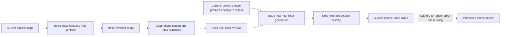

# Revoke input when the capture stream stops and recover through a new scope

Source repair; execution and end-to-end presentation evidence remain pending. This addresses the authorization gap found in the [recovery budget review](CAPTURE_RECOVERY_BUDGET_REVIEW.md), building on [stream ownership](CAPTURE_STREAM_OWNERSHIP_REVIEW.md), [wire input sessions](WIRE_INPUT_SESSION_REVIEW.md) and [phone presentation recovery](INPUT_PRESENTATION_RECOVERY_REVIEW.md). No build, typecheck, test/assertion execution, app/device/browser operation, model run, SSH retry or installed-app replacement was performed.

## First-principles findings

An authenticated input channel says who may control the Mac. It does not say whether that person currently has a usable view of it. Capture availability and connection availability must be separate conditions. Reusing the old input scope after capture loss also lets a delayed packet cross the outage even if the Mac eventually has new source output.

Previously, [HostPeerInputAuthorization](../../../host-mac/RemoteDesktopHost/HostPeerSession.swift) used only channel, hello and connection state. A ScreenCaptureKit stream failure could start recovery while held input and further packets remained authorized. The phone received no scoped indication that its screen/input lifetime had ended. The new recovery deadline limited terminal failure, but did not close this interval.

## Implemented source behavior

The Mac authority starts with capture unavailable. It now requires capture availability as well as the existing channel/hello/connection conditions. Only the current running capture attempt with admitted video output enables the capture dimension in production. Existing handshake-focused fixtures explicitly opt into initial capture availability; production keeps the closed default.

The current stream's synchronous stop callback calls `captureChanged(available: false)` before queuing recovery/error handling. That transition retires the injector session, releases its held inputs and returns the revoked acknowledgement. The posting lock still arbitrates an already executing input transaction; this does not retract input already posted before revocation. A duplicate loss is idle. Hello/reconnect callbacks cannot override unavailable capture, and restored capture cannot override disconnected or closed transport.

Capture consumers still run inside the exact stream/owner gate. Old streams cannot revoke a replacement peer through a queued output/error callback. Availability restoration rechecks the running attempt and its recorded video-output identity under that gate. Recovery deadlines remain authoritative; output after an expired episode cannot reopen capture input. This is source availability, not proof of remote presentation.

The [wire extension](../../../protocol/PROTOCOL.md#capture-loss-invalidation) negotiates `inputInvalidation: 1` independently of `inputSessions: 1`. The phone offers it only with scoped input metadata; the host returns the selected mode. Typed decoding rejects malformed and unsupported values, and neither side accepts a capability change on the existing channel.

When supported, the host sends `input_unavailable` carrying the exact revoked acknowledgement. The [client input state](../../../protocol/Swift/DirectInputSessionProtocol.swift) invalidates only its currently acknowledged scope, advances its hello revision and stops authorizing packets. Older/duplicate notifications are ignored. The new revision prevents an old duplicate acknowledgement from reopening input. If source recovery and a newer acknowledgement overtake the notification, that stale notification cannot invalidate the newer scope.

The [phone transport](../../../ios/RemoteDesktop/Transport/WebRTCTransport.swift) clears its old presentation/probe registration through the existing `onInputUnavailable` path, then sends the new hello. The existing model path clears display/frame readiness, source generations and local control state while retaining the separate TLS prompt connection. A scoped display and current frame probe are required again. The hello handler also rechecks transport readiness after a reentrant invalidation callback before installing a new presentation.

The Mac rotates host input generation when capture becomes available and the other conditions permit input. Packets buffered before the loss keep the old stamp and are rejected at admission and again by the injector's local session check. This covers both a new client hello arriving during the outage and host recovery arriving first.

A peer that previously had input but did not negotiate invalidation is closed on capture loss, including an older client that supports input stamps but cannot clear its screen in response to this new message. An initial capture failure before any input was authorized does not manufacture a legacy input lifetime. Notification failure revokes input and schedules terminal close. Hello and display send failures now follow the same terminal behavior.

Control-message sequence allocation and hello/display/invalidation sends use the peer lock, and capture-related publication remains ordered by capture admission. Close releases the peer lock before waiting for the capture gate. Native teardown is deferred when failure is detected inside a capture callback, after input has already been revoked. This does not establish that all negotiation, audio-device or channel-native behavior is race-free.

## Timeouts and compatibility

The capture-only phone handshake waits **35 seconds**, using the shared **30-second** host recovery budget plus a five-second delivery allowance. Initial and ordinary transport hello waits remain **10 seconds**; ICE recovery retains its separate existing budget. Duplicate invalidations cannot restart the capture handshake timer. Concurrent connection/capture failures may encounter a shorter existing connection deadline.

These remain provisional configured limits, not latency or resource measurements. A new phone paired with an older host that lacks this extension has no evidence that the old host will revoke input on capture failure. Do not qualify that combination as providing the new protection. Matching updated host and phone code, native message order and deployment compatibility remain unverified.

## Prepared regression evidence

Seven host methods and four client methods are authored and **unrun** in [ComputerUseTests](../../../host-mac/RemoteDesktopHostTests/ComputerUseTests.swift) and [WebRTCTransportTests](../../../ios/RemoteDesktopTests/WebRTCTransportTests.swift).

Host cases cover closed initial capture, held key/button release, inability of hello/connection callbacks to override loss, inability of capture to override transport closure, legacy reconnect behavior, strict fixed capability negotiation, scoped recovery in either notification/ack order, and current-versus-retired stream callbacks. Client cases cover offer/selection encoding, malformed scope/capability rejection, presentation/probe retirement, new hello revision, duplicate/old notification rejection and fixed negotiated mode.

The host tests use captured input events and a fake stream lifecycle. Client tests cover actual protocol/presentation value state, not a running native peer. The previously selected sidecar-recovery fixture exercises the real session-model invalidation callback with an idle TLS channel. It supports preservation of a ready prompt session and clearing of local controls, not a claim about a paused live login task. Native dispatch, held-device behavior, transport send failures and real login Resume still require execution evidence.

Source inventories select **1946 default host / 1263 focused browser-host / 55 focused capture-input host / 32 focused capture-input client** methods. The [host inventory](capture-input-host-inventory.json) retains the prior 48 recovery/input/presentation methods; the [client inventory](capture-input-client-inventory.json) retains the prior 28 activity/input methods. Client core remains **35**. Eight changed Swift files pass parse-only checks. The documentation scan checks **225 Markdown files / 1861 local targets / zero broken paths**. Whitespace validation is clean. The effective `.git/hooks` directory contains **zero executable non-sample hooks**. No assertion, compilation or natural-language qualification follows from these results.

## Remaining repair sequence

1. **Observe loss that does not terminate the stream.** Blank/suspended status, silent frame starvation, permission/display changes and a blocked capture consumer can leave old pixels without this stop callback. Add explicit availability/recovery handling with bounded waits, while distinguishing stationary idle output from actual loss.
2. **Bind reopening to actual presented media.** Record the current host-clock challenge and carry frame identity through encoding, transport, decoding and the owning renderer. A source-available flag plus a later probe callback remains insufficient. Follow the [capture evidence sequence](CAPTURE_FRAME_EVIDENCE_REVIEW.md#detailed-sequence-to-close-the-actual-recovery-gap).
3. **Handle static and foreground recovery.** Supply a bounded fresh-capture path for unchanged screens, and rearm presentation evidence when the phone becomes active. Define repeated-failure behavior across episodes and initial-capture startup limits.
4. **Qualify protocol/lifecycle composition.** Check native ordered/reliable-channel properties, queued callbacks, partial sends, close/replacement, actual release behavior and old/new app combinations. General peer negotiation/channel/audio-device concurrency remains open.
5. **Qualify login and complete goals later.** Verify that capture interruption preserves the exact paused TLS/login task, requires deliberate user Resume and uses fresh native page evidence. Then, after explicit permission, run the actual travel/concert/movie workflows and verify dates, places, availability, prices and source links independently. Resource/model work and the 8 GB target remain a later measured phase.
