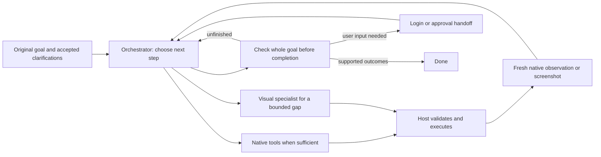

# Local computer-use loop review — September 24

The proposed loop is sound. The model proposes an operation; the host captures the screen or native state, executes the validated operation, and returns a fresh observation. Repeat until the original goal is achieved or user input is needed. Anthropic describes this action/result loop in its [computer-use guide](https://platform.claude.com/docs/en/agents-and-tools/tool-use/computer-use-tool). Browser-use keeps the original request visible and evaluates actions against their results in its [agent instructions](https://github.com/browser-use/browser-use/blob/main/browser_use/agent/system_prompts/system_prompt_no_thinking.md). These are author implementation patterns, not evidence that our local models are reliable.

The current app follows this overall structure. `ComputerUseMCPBrowserStepPlanner` proposes native browser operations or a bounded visual fallback. `MCPFirstComputerUseExecutor` owns native completion admission. `ComputerUseFaraBrowserExecutor` executes the retained browser loop and captures again. The host owns input dispatch, browser session identity, permissions, cancellation, and evidence freshness. Models propose; they do not independently operate the computer outside those gates. Separate planner and specialist roles can share a single inference slot; simultaneous model residency is not required. The 12 GB whole-Mac target remains unqualified.

Two checks serve different purposes. An action check asks whether typing, clicking, navigation, or submission produced the intended visible result. A completion check asks whether every requested outcome and condition is satisfied. A screenshot can establish a visible postcondition; a current DOM/accessibility value can be more precise. Neither a click acknowledgment nor a model's statement proves server persistence or completion of the whole task. A purchase approval question must pause the task, and login must return control to the user. Stop must prevent later effects.

The current weak point is the immutable interpretation before native work. In `ComputerUseMCPBrowserStepPlanner.propose` the model first checks prerequisites, then builds an information/action contract, then chooses a native step. `MCPFirstComputerUseExecutor` retains that contract and compares final evidence to it. Correctly represented conditions remain protected, but an omitted or misclassified requirement can block a valid task or misrepresent completion. Exact navigation receipts prove the recorded navigation, not that the model correctly associated that navigation with the user's request. The earlier Granite probe incorrectly associated search with opening a URL; those are different outcomes.

A smaller loop should retain the complete original request and ordered clarifications on every turn, choose one useful operation, and review candidate completion against the original request plus current evidence and actual operation outcomes. That final review remains fallible: host code can validate references, scope, freshness, and supported effects, but cannot mathematically prove natural-language coverage. It must not create receipts, infer approval from page text, or silently omit unfinished purchases or edits. This is a proposed change, not the current accepted implementation.

The off-source experiments and their exact structured outputs are archived separately. Their observations and operation outcomes are synthetic, with external oracles kept out of model inputs. They test planning and completion decisions, not browser effects, real login, whole-app memory, thermal behavior, or production readiness. Any implementation must first pass focused RED/GREEN checks, then the unchanged managed form workflow and handoff tests before broader website trials.

The first direct-loop probe chooses the right form submission and result answer, but misuses terminal answer for an approval question and searches instead of asking for a missing city. General terminal-tool wording corrects the purchase handoff on retest; the city decision still fails. A separate completion-verifier prototype is rejected: it fabricates an operation ID, mishandles handoff, and falsely declares an edit complete when the actual title field remains Untitled. The positive completion verdict also lacks operation bindings. Adding this extra model call to production would add complexity without qualified reliability.

[Exact requests, structured outputs, resource measurements, and external oracles](native-direct-goal-loop-results-sept24.json) preserve these results. Next, isolate the promising direct-goal action-selection path in a controlled app experiment while preserving existing completion guards. Measure the actual form workflow and its cancellation/handoff paths before deciding whether to promote the execution path. Do not turn a useful proposed action, a model verdict, or a passed synthetic case into a production completion claim.

## Direct-action integration finding — September 24

The direct-action route is implemented behind a default-off flag, but the full managed workflow is not accepted. Two runs used the same controlled local form and unchanged external oracle. Both submitted the expected query exactly once and reached the result page. Run01 then ended in `userInterventionRequired` after `askUser`. After a narrow tool-description correction, run02 selected `reviewGoal`; the legacy contract classified opening the explicitly supplied URL as an unsupported action, withheld answer capability, and the model proposed `visualFallback` with a success statement. The host ended `unableToComplete`. The test had no installed visual package, so it does not establish that an available visual route would reject this incorrect capability-gap claim. A fallback or model success statement is not task completion.

This checkpoint shows progress in choosing and executing a requested form query, while completion remains blocked by general goal-to-evidence interpretation. The description correction is not qualified for missing information or approval cases. Keep the same external oracle and host guards; next evaluate a general goal-to-evidence approach without URL/task keyword exceptions. [Exact commands, source bindings, safe structured outputs, and both failures](native-direct-action-integration-results-sept24.json).
