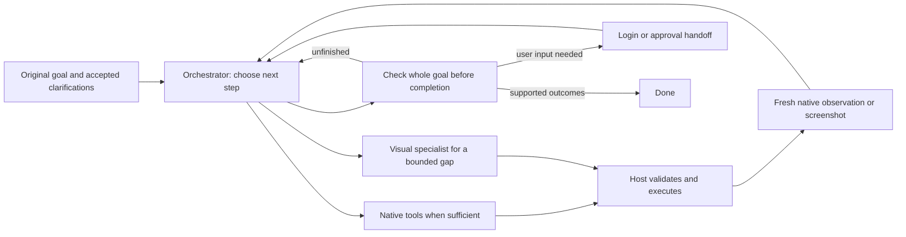

# Local computer-use loop review — September 24

The proposed loop is sound. The model proposes an operation; the host captures the screen or native state, executes the validated operation, and returns a fresh observation. Repeat until the original goal is achieved or user input is needed. Anthropic describes this action/result loop in its [computer-use guide](https://platform.claude.com/docs/en/agents-and-tools/tool-use/computer-use-tool). Browser-use keeps the original request visible and evaluates actions against their results in its [agent instructions](https://github.com/browser-use/browser-use/blob/main/browser_use/agent/system_prompts/system_prompt_no_thinking.md). These are author implementation patterns, not evidence that our local models are reliable.

The current app follows this overall structure. `ComputerUseMCPBrowserStepPlanner` proposes native browser operations or a bounded visual fallback. `MCPFirstComputerUseExecutor` owns native completion admission. `ComputerUseFaraBrowserExecutor` executes the retained browser loop and captures again. The host owns input dispatch, browser session identity, permissions, cancellation, and evidence freshness. Models propose; they do not independently operate the computer outside those gates. Separate planner and specialist roles can share a single inference slot; simultaneous model residency is not required. The 12 GB whole-Mac target remains unqualified.

Two checks serve different purposes. An action check asks whether typing, clicking, navigation, or submission produced the intended visible result. A completion check asks whether every requested outcome and condition is satisfied. A screenshot can establish a visible postcondition; a current DOM/accessibility value can be more precise. Neither a click acknowledgment nor a model's statement proves server persistence or completion of the whole task. A purchase approval question must pause the task, and login must return control to the user. Stop must prevent later effects.

The current weak point is the immutable interpretation before native work. In `ComputerUseMCPBrowserStepPlanner.propose` the model first checks prerequisites, then builds an information/action contract, then chooses a native step. `MCPFirstComputerUseExecutor` retains that contract and compares final evidence to it. Correctly represented conditions remain protected, but an omitted or misclassified requirement can block a valid task or misrepresent completion. Exact navigation receipts prove the recorded navigation, not that the model correctly associated that navigation with the user's request. The earlier Granite probe incorrectly associated search with opening a URL; those are different outcomes.

The default-off direct-answer candidate now keeps the original goal and evaluates a completion proposal in the same next-step call using current factual evidence and typed host-effect references. Host code validates references, scope, freshness, and supported effects, but cannot prove that model-authored outcomes cover the natural-language request or that an effect semantically fulfills an instruction. The candidate must not create receipts, infer approval from page text, or silently omit unfinished purchases or edits. It is implemented and fixture-tested, but not accepted as a complete workflow.

The off-source experiments and their exact structured outputs are archived separately. Their observations and operation outcomes are synthetic, with external oracles kept out of model inputs. They test planning and completion decisions, not browser effects, real login, whole-app memory, thermal behavior, or production readiness. Any implementation must first pass focused RED/GREEN checks, then the unchanged managed form workflow and handoff tests before broader website trials.

The first direct-loop probe chooses the right form submission and result answer, but misuses terminal answer for an approval question and searches instead of asking for a missing city. General terminal-tool wording corrects the purchase handoff on retest; the city decision still fails. A separate completion-verifier prototype is rejected: it fabricates an operation ID, mishandles handoff, and falsely declares an edit complete when the actual title field remains Untitled. The positive completion verdict also lacks operation bindings. Adding this extra model call to production would add complexity without qualified reliability.

[Exact requests, structured outputs, resource measurements, and external oracles](native-direct-goal-loop-results-sept24.json) preserve these results. Next, isolate the promising direct-goal action-selection path in a controlled app experiment while preserving existing completion guards. Measure the actual form workflow and its cancellation/handoff paths before deciding whether to promote the execution path. Do not turn a useful proposed action, a model verdict, or a passed synthetic case into a production completion claim.

## Direct-action integration finding — September 24

The direct-action route is implemented behind a default-off flag, but the full managed workflow is not accepted. Two runs used the same controlled local form and unchanged external oracle. Both submitted the expected query exactly once and reached the result page. Run01 then ended in `userInterventionRequired` after `askUser`. After a narrow tool-description correction, run02 selected `reviewGoal`; the legacy contract classified opening the explicitly supplied URL as an unsupported action, withheld answer capability, and the model proposed `visualFallback` with a success statement. The host ended `unableToComplete`. The test had no installed visual package, so it does not establish that an available visual route would reject this incorrect capability-gap claim. A fallback or model success statement is not task completion.

This checkpoint shows progress in choosing and executing a requested form query, while completion remains blocked by general goal-to-evidence interpretation. The description correction is not qualified for missing information or approval cases. Keep the same external oracle and host guards; next evaluate a general goal-to-evidence approach without URL/task keyword exceptions. [Exact commands, source bindings, safe structured outputs, and both failures](native-direct-action-integration-results-sept24.json).

## Supplied-URL reference repair and managed retest — September 24

The browser goal request now includes the host's supplied-URL reference map. The model's `openURL` effect names a closed reference ID, which the host resolves to the exact URL retained by the existing navigation-receipt checks. GREEN01 compiled with zero errors and passed all 11 focused tests with no failures or skips. The build recorded 16 warnings; tests recorded one main-thread runtime warning. This verifies the protocol and guarded execution path, not natural-language classification.

The unchanged managed form workflow E2E03 still fails semantic qualification. It opened `/index`, submitted `/search?query=Apollo+11` exactly once, and observed the expected heading in 54.75 seconds across six model exchanges with one worker. The interpreted contract nevertheless classified opening the explicitly supplied URL as unsupported; the model then called `askUser` with a success sentence, and the task ended `userInterventionRequired`. The action/result loop remains sound, while the semantic completion layer remains brittle. The direct-action route stays default-off; no model or whole-workflow promotion follows. The next bottleneck is goal interpretation and terminal-tool selection, which needs evidence across the unchanged workflow and its negative cases rather than a keyword exception or an unqualified classifier change. [Focused protocol and managed E2E03 evidence](native-url-effect-reference-results-sept24.json).

## Atomic direct-completion candidate screen — September 24

A one-call atomic answer candidate was evaluated off-source against two frozen synthetic requests using Qwen 3.5 4B and AgentCPM-Explore. The form-result case is not qualified by either model: Qwen cites the correct heading but omits a distinct search/form outcome; AgentCPM cites only the source URL, omits action bindings, and invents a “no additional actions needed” constraint. Qwen fails the approval-handoff case by asking for approval inside answer text and weakening purchase to waiting. AgentCPM correctly calls `askUser`, passing that decision only. Four planned cases were not run. This atomic protocol is rejected for now; it was not implemented or compiled in the app. This screen does not justify model promotion or additional prompt variants. [Exact requests, external oracle, model pins, full source freeze, structured call arguments and scoped outcomes](native-direct-completion-candidates-results-sept24.json).

A separate source review found that the legacy `visualFallback` tool schema contains only a free-text description ([planner](../../../host-mac/RemoteDesktopHost/ComputerUse/ComputerUseMCPBrowserStepPlanner.swift#L431)); MCP-first converts it to a handoff ([native proposal admission](../../../host-mac/RemoteDesktopHost/ComputerUse/MCPFirstComputerUseExecutor.swift#L1093)), and the retained loop can call the visual planner ([handoff execution](../../../host-mac/RemoteDesktopHost/ComputerUse/ComputerUseFaraBrowserExecutor.swift#L326)). There is no typed observed-capability-gap field in that proposal. The prior managed run had no installed visual package, so behavior with an available visual package remains untested. This is a source-review limitation, not a result established by the atomic probe.

## Goal-contract schema interface probe — September 24

A bounded paired run compared the production strict `response_format` schema with a required strict `interpretGoal` native function using identical messages, schema parameters, sampler, model and token budget. The pinned llama.cpp b9992 documentation says JSON Schema constrains output without appearing in the prompt, while tool schemas are injected into the prompt ([pinned schema documentation](https://github.com/ggml-org/llama.cpp/blob/b9992/grammars/README.md#L322-L323)). Rendered prompt markers confirmed that distinction for both model templates: structural markers were absent for JSON-schema requests and present for function requests. Qwen input counts were 314/841 tokens; LFM preflight counted 305/645 and completion usage reported 306/646.

The interface change did not fix interpretation. Qwen marked the explicit supplied URL visit unsupported in both formats; its function output also turned search and heading reporting into an unsupported action. LFM JSON output marked the URL visit unsupported, failed to retain search/report as an information requirement, and invented a “report only the heading” constraint. Its native-function output instead contained malformed requirement objects: the URL action lacked `expectedEffect`, and the information object lacked `instruction` and `kind`. These arguments would be rejected by the production schema/Swift decoder; no Swift decoder replay was run. Both models failed the separate oracle, so the native-function interface is rejected for this defect and prepared purchase/edit follow-ups were skipped. LFM used one worker, peaked at 2,471,526,400 sampled process bytes, exited cleanly and removed its temporary credential. Root confirmed all 17 frozen source hashes matched before and after at clean HEAD `c7a1189`; the freshly restored LFM weights were later removed, while model pins and prior evidence remain. No app source changed. [Exact request bodies, sanitized arguments, oracle, commands, pins, source freezes, resource evidence and cleanup record](native-goal-function-interface-results-sept24.json).

## Native GET receipt propagation and managed retest — September 24

The host now retains a typed native GET form receipt across the fresh capture and exposes the bounded effect fields in the next same-task, same-goal, same-browser-session planner context. A deterministic owned-browser test first shows a matching heading on the search page before any GET; forged model history produces no host-verified effect and no request. It then executes the real controlled GET and verifies the receipt in the next planner context, while preserving submit-once and replay checks. The focused RED compiled and failed only because `observedGETSubmissions` was absent. GREEN passed all three selected form tests with zero failures, skips, runtime warnings, or build errors. It recorded 41 compiler warnings, none on changed lines.

Managed direct-form run04 exercises the updated build but does not pass the full workflow. The model opens `/index`, submits `/search?query=Apollo+11` exactly once, and the fresh page contains the expected heading. Across six inspected model exchanges in 51.576 seconds with at most one worker, the interpreted contract marks the supplied `/index` visit unsupported; the final tool call asks whether the already-found heading is correct. The host ends `userInterventionRequired` (0 passed, 1 failed, 0 skipped); the build has zero compiler errors/warnings and the run has one main-thread responsiveness warning. All 17 source hashes match after execution and match the common sources from focused GREEN; GREEN has one additional DOM test source. No inference-call count is inferred from the harness's `totalPlannerCalls` field.

This validates the host receipt-propagation repair and leaves natural-language completion unresolved. The matching-heading/no-search case is a scripted host-context assertion; it does not test model refusal or terminal acceptance. Capture-failure Resume was not exercised. The direct-answer candidate is now implemented behind the default-off path, with the focused fixture results and limitations recorded below. No model or runtime budget changed. [Exact RED/GREEN records, source hashes, managed command, sanitized exchanges and outcomes](native-form-effect-retention-results-sept24.json).

## Direct-answer candidate checkpoint and next E2E priority — September 24

The direct-answer candidate passed GREEN02: 8 focused tests passed, with no failures, skips, or runtime warnings; compilation had 0 errors and 9 warnings, and 18 source hashes remained stable. This establishes structural decoding and host-effect/reference binding on fixtures, not model semantic coverage. Host-verified GET receipts can establish that the recorded browser effect occurred in the current task/session; they cannot establish that the model decomposed the user's goal completely or correctly associated an instruction with that effect. The candidate remains default-off. Managed direct-form run05 is deferred and unexecuted, so the unchanged managed workflow has not validated this path. [Exact direct-answer results, limits, and deferral](native-direct-answer-results-sept24.json).

The next acceptance target is a natural-language Drive upload: select the most recent presentation in Downloads and upload it to the default signed-in Drive account. If similarly named specification spreadsheets make file identity ambiguous, ask one multiple-choice clarification listing the candidates with distinguishing details such as name, date, type, and size. Preserve the selected file identity across Pause/Resume; require reselection if the file changes or disappears; prevent duplicate uploads and any post-Stop upload. Verify the exact selected content through fresh Drive upload/new-item evidence and, where possible, a test readback hash so a pre-existing same-name file cannot satisfy the oracle. Use the user's owned login or a supported profile; hand off if authentication is needed, and do not copy credentials. This E2E is not implemented or proven: the owned browser session is ephemeral and file-open-panel handling is absent. The email-to-self attachment variant remains a follow-up acceptance case after Drive.
